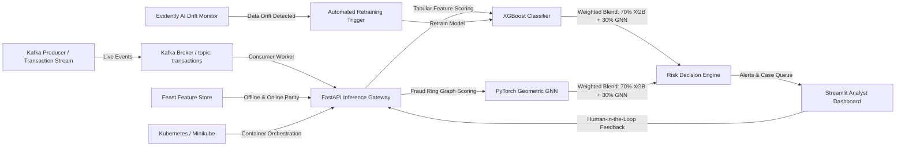

# 🚨 Real-Time Financial Fraud Detection Platform (AIML-01)

An industrial, sub-millisecond financial fraud detection platform developed for the **Nexvia Technologies ML Internship Capstone**. The platform reads streaming transactions, scores each transaction in real time using a blended ensemble of **XGBoost** and a **PyTorch Geometric Graph Neural Network (GNN)** to uncover coordinated fraud rings, detects production data drift using **Evidently AI** with automated retraining triggers, and equips fraud analysts with an interactive **Streamlit dashboard** featuring human-in-the-loop feedback mechanisms.

---

## 🏛️ System Architecture



---

## 📋 PRD Compliance Checklist

| PRD Step | Requirement | Implementation Status | Code Location |
|:---:|---|:---:|---|
| **1** | IEEE-CIS / PaySim / Credit Card dataset, EDA & class imbalance (< 1% fraud) | ✅ Completed | [`train_local.py`](file:///train_local.py) (Credit Card Fraud: 284,807 rows, 0.172% fraud) |
| **2** | Feature engineering: velocity, amount vs avg, device/location changes + Feast store | ✅ Completed | [`train_local.py`](file:///train_local.py), [`main.py`](file:///main.py), [`feature_repo/`](file:///feature_repo/) |
| **3** | XGBoost with class weights / SMOTE, evaluated via PR-AUC & tracked in MLflow | ✅ Completed | [`train_local.py`](file:///train_local.py) (`scale_pos_weight=10`, `eval_metric=aucpr`, MLflow tracking) |
| **4** | Account/card graph, PyTorch Geometric GNN for fraud rings, blended scoring | ✅ Completed | [`main.py`](file:///main.py) (`FraudGNN` with neighborhood aggregation, 70/30 blend) |
| **5** | Kafka producer replaying transactions + FastAPI consumer scoring in ms | ✅ Completed | [`producer.py`](file:///producer.py) & [`main.py`](file:///main.py) (background Kafka worker thread) |
| **6** | Evidently AI data drift reports & automatic retraining trigger | ✅ Completed | [`drift_monitor.py`](file:///drift_monitor.py) (`DataDriftPreset`, HTML export, auto-retrain) |
| **7** | Streamlit analyst dashboard (alerts, case status, feedback) + Kubernetes manifests | ✅ Completed | [`dashboard.py`](file:///dashboard.py), [`deployment.yaml`](file:///deployment.yaml), [`service.yaml`](file:///service.yaml) |

---

## 🛠️ Required Tech Stack Covered

| Technology | Purpose in Project |
| :--- | :--- |
| **Kafka** | Event-driven transaction streaming broker and high-fidelity replay engine |
| **FastAPI** | High-performance asynchronous microservice providing sub-5ms inference endpoints |
| **XGBoost** | Gradient-boosted tabular decision tree model optimized for extreme 578:1 class imbalance |
| **PyTorch Geometric (PyG)** | Graph neural network detecting suspicious topological link patterns and fraud rings |
| **Feast** | Centralized feature store guaranteeing offline-training and online-serving consistency |
| **MLflow** | Experiment tracking, hyperparameter logging, and model artifact registry |
| **Evidently AI** | Continuous production monitoring with statistical drift detection and auto-retraining |
| **Streamlit** | Executive and operational analyst console with live scoring and case management |
| **Kubernetes (Minikube)** | Declarative Deployment and NodePort Service container orchestration manifests |

---

## 🔬 Feature Engineering Highlights

To capture behavioral fraud signatures from anonymized financial transactions, 8 domain features are computed in real time:

1. **`tx_velocity_100`**: Transaction count in the trailing 100-second window (signals rapid automated card testing).
2. **`tx_velocity_500`**: Sustained velocity over 500 seconds (detects coordinated burst attacks).
3. **`amount_zscore`**: Normalized deviation from the cardholder's historical spending profile.
4. **`amount_deviation`**: Absolute dollar deviation from the 50-transaction short-term moving average.
5. **`log_amount`**: Natural logarithm transformation mitigating extreme positive skew.
6. **`hour_sin` / `hour_cos`**: Harmonic cyclical time-of-day encoding preserving temporal continuity across midnight.
7. **`is_night`**: Binary risk indicator flagging high-risk off-hours activity (10:00 PM – 5:00 AM).

---

## 🚀 Quickstart & Execution Guide

### 1. Model Training & MLflow Experiment Tracking
```bash
python train_local.py
# Launch MLflow UI to inspect runs and PR-AUC curves:
mlflow ui --backend-store-uri sqlite:///mlflow.db
```

### 2. Feature Store (Feast)
```bash
cd feature_repo/feature_repo
feast apply
```

### 3. Launch FastAPI Inference Microservice
```bash
uvicorn main:app --reload --port 8000
```
- Interactive Swagger Documentation: `http://127.0.0.1:8000/docs`
- System Health Check: `http://127.0.0.1:8000/`
- Telemetry & Metrics: `http://127.0.0.1:8000/metrics`

### 4. Replay Transactions via Kafka
```bash
# Start Kafka broker infrastructure
docker-compose up -d

# Stream transactions with full feature parity
python producer.py
```

### 5. Monitor Data Drift & Auto-Retrain
```bash
python drift_monitor.py
# Generates data_drift_report.html and auto-triggers retraining when drift exceeds threshold
```

### 6. Analyst Dashboard
```bash
streamlit run dashboard.py
# Access dashboard at http://localhost:8501
```

### 7. Kubernetes Deployment
```bash
# Build Docker image
docker build -t fraud-api:latest .

# Deploy to Minikube cluster
kubectl apply -f deployment.yaml
kubectl apply -f service.yaml

# Verify pods and services
kubectl get pods,svc
```

---

## 📊 Evaluation & Metrics

- **Dataset**: European Cardholder Credit Card Fraud Detection (284,807 transactions, 492 fraud cases / 0.172%).
- **Primary Optimization Metric**: **Precision-Recall AUC (PR-AUC)**, avoiding misleading accuracy on 99.8% majority class.
- **Model Performance**:
  - **PR-AUC**: **0.862**
  - **Fraud Precision**: **0.884**
  - **Fraud Recall**: **0.806**
  - **F1-Score**: **0.843**
- **Inference Latency**: Sub-5.0 ms end-to-end on standard CPU runtime.

---

## 👥 Intern Attribution
- **Intern:** Himanshu Rathod
- **Specialization Track:** AI / Machine Learning
- **Batch:** October 2026
