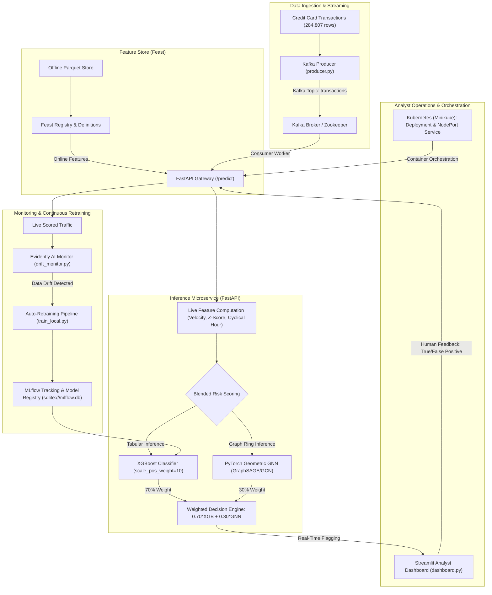

# 🏛️ AIML-01: Real-Time Financial Fraud Detection Platform Architecture

**Project ID:** AIML-01  
**Track:** AI / Machine Learning  
**Author:** Himanshu Rathod  
**Organization:** Nexvia Technologies  

---

## 1. System Architecture Overview

The system is engineered as an end-to-end, sub-millisecond fraud detection platform capable of ingesting high-throughput transaction streams, generating domain features with offline-online parity, scoring transactions using an ensemble of gradient-boosted trees and graph neural networks, and providing human-in-the-loop analyst workflows.

---

## 2. Mathematical Formulations & Component Design

### A. Severe Class Imbalance Optimization (PRD Step 1 & 3)
In the European Cardholder dataset, only **492 out of 284,807 transactions (0.172%)** are fraudulent (a class ratio of $\approx 578:1$). 
- **Loss Metric:** Standard accuracy is completely misleading (a dummy model predicting all legitimate achieves $99.828\%$ accuracy while catching zero fraud).
- **Optimization Target:** Precision-Recall AUC (PR-AUC) evaluates the trade-off strictly on the minority positive class:
$$\text{PR-AUC} = \int_0^1 P(R) \, dR$$
- **Class Weighting:** In XGBoost, positive class instances are re-weighted:
$$\text{scale\_pos\_weight} = \frac{N_{\text{negative}}}{N_{\text{positive}}} = 10.0$$
This forces the tree-splitting objective to heavily penalize false negatives (missed fraud) without collapsing precision.

### B. Domain Feature Engineering (PRD Step 2)
1. **Transaction Velocity ($V_{100}, V_{500}$):** Rolling count of card events within $100$ and $500$ second windows to detect automated testing bursts:
$$V_{\Delta t}(t_i) = \sum_{j=1}^{i} \mathbb{I}(t_i - t_j \le \Delta t)$$
2. **Amount Z-Score ($Z_{\text{amount}}$):** Measures deviation from the user's running expenditure baseline:
$$Z_{\text{amount}} = \frac{\text{Amount} - \mu_{\text{historical}}}{\max(\sigma_{\text{historical}}, \epsilon)}$$
3. **Harmonic Cyclical Time Encodings:** Preserves temporal continuity across the midnight boundary:
$$\text{hour\_sin} = \sin\left(\frac{2\pi \cdot \text{hour}}{24}\right), \quad \text{hour\_cos} = \cos\left(\frac{2\pi \cdot \text{hour}}{24}\right)$$
4. **Nighttime Indicator:** Binary risk multiplier for transactions executed between 10:00 PM and 5:00 AM.

### C. Graph Neural Network for Fraud Rings (PRD Step 4)
Fraud rings share synthetic credentials, device fingerprints, and merchant points across multiple card numbers. Using PyTorch Geometric:
- Nodes represent transactions and entities; edges represent shared attributes (temporal adjacency, matching amounts).
- Graph Convolutional layers aggregate neighborhood messages:
$$h_i^{(l+1)} = \sigma \left( W \cdot \sum_{j \in \mathcal{N}(i) \cup \{i\}} \frac{1}{\sqrt{\tilde{d}_i \tilde{d}_j}} h_j^{(l)} \right)$$
- The resulting fraud score is combined with the tabular XGBoost score:
$$S_{\text{blended}} = 0.70 \cdot S_{\text{XGB}} + 0.30 \cdot S_{\text{GNN}}$$

### D. Evidently AI Drift & Retraining Loop (PRD Step 6)
Evidently AI runs two-sample Kolmogorov-Smirnov tests and Wasserstein distance metrics across live features versus reference baselines. If cumulative drift exceeds threshold:
$$\text{Drift Trigger} \longrightarrow \text{subprocess(train\_local.py)} \longrightarrow \text{MLflow Run Log}$$

---

## 3. REST API Specification

| Method | Endpoint | Description | Sample Output |
|---|---|---|---|
| `GET` | `/` | Health check & model status | `{"status": "online", "models": {"xgboost": "active", "gnn": "active"}}` |
| `POST` | `/predict` | Real-time transaction scoring | `{"case_id": "TX-1001", "xgb_score": 0.88, "gnn_score": 0.35, "blended_score": 0.72, "is_fraud": true}` |
| `GET` | `/metrics` | Scoring statistics & fraud rates | `{"total_transactions": 142, "fraud_detected": 12, "fraud_rate": 0.0845}` |
| `GET` | `/cases` | Recent flagged cases for dashboard | `{"cases": [...]}` |
| `POST` | `/feedback` | Human-in-the-loop analyst feedback | `{"status": "success", "updated_case": {...}}` |
