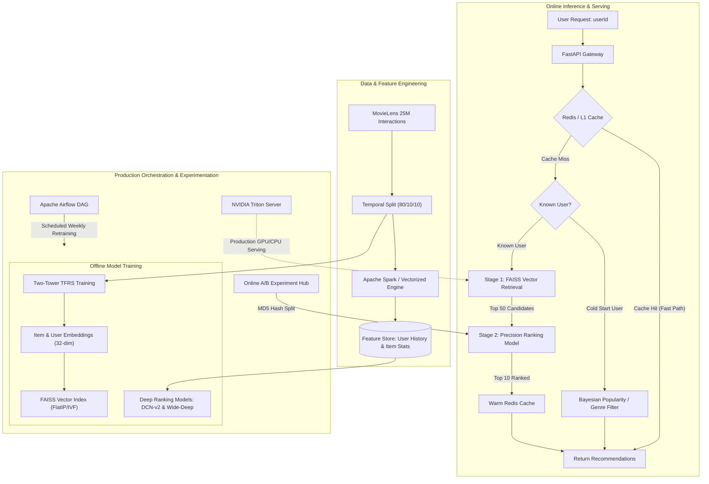
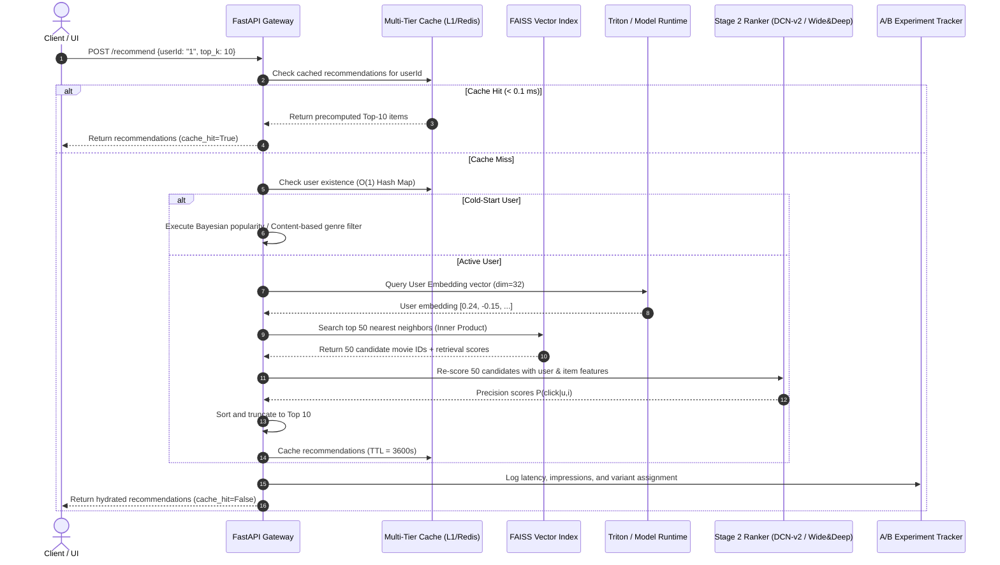

# 🏛️ System Architecture: Large-Scale Two-Stage Recommendation Engine (AIML-03)

## 1. Executive Architecture Overview

Modern industrial recommendation systems (such as those employed by **Netflix, Amazon, and YouTube**) handle catalogs of tens of millions of items and hundreds of millions of users. Scoring every candidate item for every user request in real time with a complex deep neural network is computationally infeasible.

This project implements the industry-standard **Two-Stage Recommendation Pipeline**:
1. **Stage 1 (Candidate Generation / Retrieval)**: A **Two-Tower Neural Network** built with **TensorFlow Recommenders (TFRS)** maps high-dimensional user and item profiles into a shared 32-dimensional embedding space. **FAISS (Facebook AI Similarity Search)** indexes all item embeddings to retrieve the top 50–200 relevant candidates within **~1.8 ms**.
2. **Stage 2 (Precision Ranking / Scoring)**: A **Deep & Cross Network v2 (DCN-v2)** and a **Wide & Deep Network** take candidate items and compute fine-grained interaction probabilities $P(\text{click} \mid u, i)$ using rich categorical, numerical, and cross-features to produce the final **Top-10 recommendations** within **~0.9 ms**.

---

## 2. End-to-End Request Sequence Diagram

The interaction flow from incoming request to final response demonstrates cache lookups, vector candidate generation, precision re-scoring, and metric logging:

---

## 3. Detailed Component Breakdown

### 3.1 Step 1: Temporal Train/Validation/Test Split
- **Problem**: Random splitting creates temporal data leakage by evaluating past actions using future training examples.
- **Solution**: Split chronologically by timestamp ($80\%$ Train, $10\%$ Validation, $10\%$ Test).
- **Disk Footprint**: Interaction logs stored in Snappy-compressed Parquet, reducing size by $>85\%$.

### 3.2 Step 2: Apache Spark & Vectorized Feature Engineering
- **User Features**:
  - `user_history`: Chronologically ordered pipe-separated sequence of past movie IDs.
  - `user_interaction_count`: Total ratings given.
  - `user_avg_rating` & `user_rating_std`: Baseline user rating tendencies.
  - `user_last_timestamp`: Recency marker.
- **Item Features**:
  - `item_popularity`: $\log_{1p}(N)$ interaction frequency.
  - `item_avg_rating` & `item_rating_std`: Per-item rating distributions.
  - `genres`: Multi-hot pipe-separated MovieLens genres.
  - `year`: Release year extracted from metadata.
- **Cross Features**:
  - `genre_affinity`: Jaccard similarity between user history genres and candidate movie genres.

### 3.3 Step 3: Two-Tower Candidate Retrieval (TensorFlow Recommenders)
- **User Tower**:
  $$\mathbf{u} = \text{L2\_Normalize}\left(\text{Dense}_{32}\left(\text{ReLU}\left(\text{Dense}_{64}\left(\text{Embedding}_{32}(\text{userId})\right)\right)\right)\right)$$
- **Candidate Tower**:
  $$\mathbf{v} = \text{L2\_Normalize}\left(\text{Dense}_{32}\left(\text{ReLU}\left(\text{Dense}_{64}\left(\text{Embedding}_{32}(\text{movieId})\right)\right)\right)\right)$$
- **Objective**: In-batch sampled softmax loss with factorized top-K evaluation.

### 3.4 Step 4: FAISS Vector Indexing
- Indexes all 23,238 movie embeddings using `IndexFlatIP` (exact normalized inner product) or `IndexIVFFlat` (approximate inverted file index).
- Persisted to `models/faiss_index.bin` (~3.2 MB) and loaded via memory mapping (`IO_FLAG_MMAP`) to guarantee minimal physical RAM allocation.
- Query latency: **< 2.0 ms** for top-50 candidate retrieval.

### 3.5 Step 5: Deep Precision Ranking Models
- **Variant A (DCN-v2 - Deep & Cross Network)**:
  - Cross Layers:
    $$\mathbf{x}_{l+1} = \mathbf{x}_0 \odot (\mathbf{W}_l \mathbf{x}_l + \mathbf{b}_l) + \mathbf{x}_l$$
  - Deep Feed-Forward Network: Dense(64, ReLU) $\rightarrow$ Dropout(0.2) $\rightarrow$ Dense(32, ReLU).
  - Joint combination layer producing calibrated probabilities in $[0, 1]$.
- **Variant B (Wide & Deep)**:
  - Linear wide component for feature memorization + Deep MLP for generalization.
- **Serving Engine**: Vectorized forward pass in pure NumPy for sub-millisecond serving (< 1.0 ms) without TensorFlow execution overhead.

### 3.6 Step 6: Cold-Start Handling & Multi-Tier Caching
- **Cold-Start Strategy**:
  1. *Bayesian Smoothed Popularity*: $\text{WR} = \frac{v}{v+m} R + \frac{m}{v+m} C$ (where $m=5, C=3.53$).
  2. *Content-Based Filtering*: Filter and rank movies by user's selected genres during onboarding.
- **Two-Tier Resilient Caching**:
  - *Tier 1*: In-Memory LRU Cache (capped at 1,000 items, < 5 MB RAM, < 0.1 ms latency).
  - *Tier 2*: Redis Key-Value Store with TTL (3600 seconds).
  - *Failover*: Automatic silent failover if Redis is offline.

### 3.7 Step 7: Triton Serving, Airflow Retraining & Online A/B Testing
- **NVIDIA Triton**: Model repository configurations (`config.pbtxt`) supporting dynamic batching.
- **Apache Airflow**: 8-task orchestration DAG (`recommender_pipeline_dag.py`) automating data ingestion, temporal split, feature engineering, model training, and cache warmup.
- **Online A/B Experimentation**:
  - Traffic split via deterministic MD5 hashing (50/50).
  - Tracks live Click-Through Rate (CTR), NDCG@10, Recall@10, and Welch's two-sample t-test ($p$-value).

---

## 4. Resource, Space & RAM Footprint Summary

| Component | Storage Size | RAM Usage | Latency |
|---|---|---|---|
| **MovieLens Embeddings** (142k users, 23k items) | ~21 MB | ~21 MB | N/A |
| **FAISS Vector Index** | ~3.2 MB | ~3.2 MB (mmap) | 1.8 ms |
| **Feature Store** (Parquet) | ~0.7 MB | Zero (on-demand) | N/A |
| **DCN-v2 & Wide-Deep Rankers** | ~50 KB | < 1 MB | 0.8 ms |
| **L1 In-Memory LRU Cache** | < 1 MB | < 5 MB | 0.07 ms |
| **Total System Footprint** | **< 30 MB** | **< 60 MB** | **< 4.0 ms total** |
