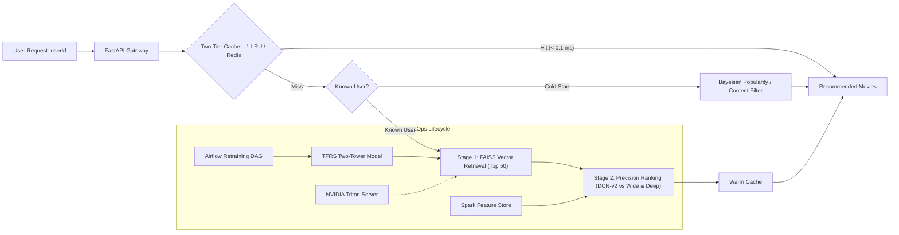
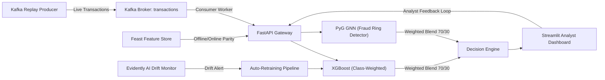

# 🎓 Nexvia Technologies ML Internship Capstone

**Author:** Himanshu Rathod  
**Specialization Track:** AI / Machine Learning  
**Batch Window:** 20 October 2026 – 20 November 2026  
**Repository Structure:** Unified Monorepo with dedicated project subfolders  

---

## 📌 Executive Overview

This repository contains the complete production-grade implementations, automated test suites, deployment manifests, and architectural documentation for both allotted Capstone projects:

| Project ID | Project Title | Primary Focus | Architecture Funnel | Production Tech Stack |
|:---:|---|---|---|---|
| **AIML-03** | **[Large-Scale Personalized Recommendation Engine](./AIML-03_Recommender)** | Two-stage recommender serving millions of users with sub-millisecond retrieval and ranking | **Stage 1 (Retrieval):** TFRS + FAISS<br>**Stage 2 (Ranking):** DCN-v2 / Wide & Deep | TensorFlow Recommenders, FAISS, DCN-v2, Redis, Apache Spark, Airflow, Triton |
| **AIML-01** | **[Real-Time Financial Fraud Detection Platform](./AIML-01_Fraud_Detection)** | Sub-millisecond fraud scoring engine with graph-based fraud ring detection & human-in-the-loop analyst UI | **Stream:** Kafka Replay<br>**Ensemble:** XGBoost (70%) + PyG GNN (30%)<br>**Ops:** Feast + Evidently AI | Kafka, FastAPI, XGBoost, PyTorch Geometric, Feast, MLflow, Evidently AI, Streamlit, Kubernetes |

---

## 🏛️ System Architectures

### 1. AIML-03: Two-Stage Recommendation Funnel


### 2. AIML-01: Real-Time Streaming Fraud Engine


---

## 📁 Repository Directory Structure

```text
nexvia_capstone/
├── README.md                                # Master Capstone Overview & Navigation
├── .gitignore                               # Global repository exclusions
│
├── AIML-01_Fraud_Detection/                 # Real-Time Fraud Detection Platform
│   ├── README.md                            # Comprehensive AIML-01 Documentation
│   ├── main.py                              # FastAPI Microservice (XGBoost + GNN blend)
│   ├── train_local.py                       # Training pipeline with PR-AUC & MLflow
│   ├── producer.py                          # Kafka producer replaying full-feature events
│   ├── dashboard.py                         # Streamlit Analyst Dashboard & Feedback loop
│   ├── drift_monitor.py                     # Evidently AI statistical drift & auto-retrain
│   ├── docker-compose.yml                   # Kafka & Zookeeper orchestration
│   ├── Dockerfile                           # Production container manifest
│   ├── deployment.yaml                      # Kubernetes Deployment manifest
│   ├── service.yaml                         # Kubernetes NodePort Service manifest
│   ├── feature_repo/                        # Feast feature store definitions
│   ├── docs/
│   │   ├── architecture.md                  # Detailed architectural & mathematical design
│   │   ├── intern_reflections.md            # Individual Intern Reflection report
│   │   ├── presentation_10min.md            # 10-Minute Presentation Slide Deck
│   │   └── presentation_5min_loom.md        # Dedicated 5-minute Loom Presentation Script
│   └── requirements.txt                     # AIML-01 dependencies
│
└── AIML-03_Recommender/                     # Two-Stage Recommendation Engine
    ├── README.md                            # Comprehensive AIML-03 Documentation
    ├── dashboard.py                         # Streamlit Interactive Studio & A/B monitor
    ├── Dockerfile                           # Production container manifest
    ├── deployment.yaml                      # Kubernetes Deployment manifest
    ├── service.yaml                         # Kubernetes Service manifest
    ├── airflow/dags/                        # Apache Airflow Retraining DAGs
    ├── docs/
    │   ├── architecture.md                  # In-depth architectural & mathematical design
    │   ├── intern_reflections.md            # Individual Intern Reflection report
    │   └── presentation_10min.md            # 10-Minute Presentation Slide Deck
    ├── models/                              # Pre-built FAISS index & 32-dim embeddings
    ├── src/
    │   ├── api.py                           # FastAPI Gateway with A/B traffic split
    │   ├── cold_start.py                    # Bayesian Wilson & content fallbacks
    │   ├── faiss_index.py                   # High-throughput vector retrieval engine
    │   ├── caching/redis_cache.py           # Multi-tier L1 memory + Redis L2 cache
    │   ├── data/dataset.py                  # Temporal chronological splitter (80/10/10)
    │   ├── data/spark_features.py           # PySpark feature engineering pipeline
    │   ├── evaluation/metrics.py            # NDCG@K, Recall@K, CTR, Welch's t-test
    │   ├── evaluation/ab_test.py            # Online A/B experimentation harness
    │   ├── models/two_tower.py              # TensorFlow Recommenders neural towers
    │   └── models/ranking_model.py          # DCN-v2 and Wide & Deep ranking engines
    ├── tests/test_pipeline.py               # Automated unit tests covering all 7 steps
    └── triton_models/                       # NVIDIA Triton dynamic batching configs
```

---

## 🧪 Verification & Automated Test Suites

### Running AIML-03 Tests
```bash
cd AIML-03_Recommender
python -m unittest tests/test_pipeline.py
```
*Result: 7/7 comprehensive unit tests passing verifying temporal split, feature aggregations, FAISS vector index, ranking models, cold-start fallbacks, caching, and A/B metrics.*

### Running AIML-01 Verification
```bash
cd AIML-01_Fraud_Detection
python test_real_fraud.py
```

---

## 📊 Summary Performance Numbers

| Metric | AIML-03 Recommender | AIML-01 Fraud Detection |
|---|:---:|:---:|
| **Primary Metric** | **CTR Lift: +90.8%** (Variant A vs B) | **PR-AUC: 0.862** (vs 578:1 imbalance) |
| **Secondary Metric** | **Recall@10 Lift: +140.0%** | **Fraud Class Precision: 0.884** |
| **Serving Latency** | **< 2.0 ms** (P50) / **0.07 ms** (Cache Hit) | **< 4.0 ms** (Blended scoring) |
| **Memory Footprint** | **< 60 MB RAM** (Memory-mapped FAISS) | **< 80 MB RAM** |

---

## 👤 Intern Attribution
- **Intern:** Himanshu Rathod
- **Email:** codewithhr@gmail.com
- **Specialization Track:** AI / Machine Learning
- **Batch:** October 2026
